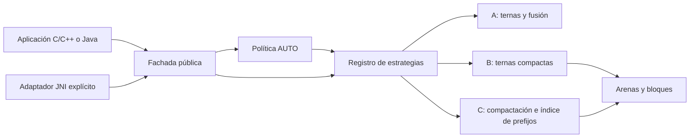

# Arquitectura TSPR3

La implementación actual se organiza con **Facade + Strategy + Selection Policy**.
Las fachadas públicas validan contratos y devuelven resultados; las estrategias
ordenan; las políticas deciden qué estrategia usar. Los experimentos no forman
parte de la biblioteca distribuida.

## Responsabilidades y dependencias

| Área | Responsabilidad |
|---|---|
| `include/tspr3` | API C y adaptador C++17, sin tipos internos. |
| `src/c/tspr3_library.c` | Fachada C: opciones, errores, buffers y diagnóstico. |
| `src/c/tspr3_tri.c` | Implementaciones A/B/C y registro constante de callbacks. |
| `src/c/tspr3_log_selector.c` | Política predictiva, margen y presupuesto de heap. |
| `src/c/tspr3_profile.c` | Extracción acotada de indicadores. |
| `src/c/internal` | Contratos internos y pesos compilados. |
| `java/.../Tspr3.java` | Fachada Java compatible con la API anterior. |
| `OrderingStrategy`, `FrequencyStrategy` | Contratos distintos para ordenar y compactar. |
| `PlainTriads`, `CompactTriads` | Estrategias Java sin estado compartido mutable. |
| `Strategies` | Registro inmutable de estrategias. |
| `SamplingSelector` | Política Java, independiente de las implementaciones. |
| `NativeTspr3`, `java/native` | Adaptador opcional entre Java y C. |
| `models/c` | Procedencia y parámetros del ajuste C. |
| `benchmarks`, `tools/analysis` | Generación de evidencia y análisis; no se enlazan a la biblioteca. |
| `experiments/legacy` | Código anterior, incluido el ensayo radix, conservado para reproducibilidad. |

Se separaron las capacidades: A no implementa la interfaz de frecuencias. B y C
comparten el motor de registros compactos, pero se registran como estrategias
diferentes. Los buffers y árboles pertenecen a cada llamada; los objetos de
estrategia y las tablas de pesos son inmutables. El registro no admite AUTO:
la política debe resolverlo antes del despacho.

En C, una tabla constante de punteros a funciones cumple el mismo papel que las
interfaces Java. La validación precede al acceso por enum, y una capacidad de
índice ausente rechaza A en la interfaz compacta. No se alteraron las operaciones
de ternas, la conservación de multiplicidades ni las condiciones de concatenación.

## Contratos preservados

- Entrada inmutable y salida completa con el mismo multiconjunto.
- A/B/C siguen siendo explícitas; AUTO no sustituye el algoritmo por radix.
- La interfaz compacta mantiene `(valor,cantidad)` y rechaza A.
- Las decisiones por muestra solo afectan rendimiento, nunca corrección.
- Los pesos C no se transfieren a Java sin recalibración.
- Los límites de memoria no incluyen buffers del llamador ni memoria residente total.
- La API pública continúa especializada en `int32_t`/`int`; los registros genéricos son una etapa futura.

## Por qué esta refactorización

La clase Java original mezclaba API, selección, tres ordenamientos y almacenamiento.
Ahora la fachada depende de contratos y la política puede evolucionar sin editar
los motores. En C, el despacho y la selección ya no dependen de una cadena de
condicionales para cada implementación. El código experimental tiene rutas de
compilación propias y no expone símbolos ajenos en los headers públicos.

Los scripts comparten descubrimiento de MSVC/CMake/JDK mediante
`scripts/common/Toolchain.ps1`. `build.ps1` ofrece una entrada única. CMake prueba
API, núcleo, política y consumidores instalados. Maven ejecuta las pruebas de
contrato reales mediante Ant porque son programas Java autónomos, no pruebas JUnit.

## Extensión futura a estructuras

Antes de añadir registros se definirá una clave extraída y una salida por índices
o permutación. Dos claves iguales no implican dos registros idénticos: colapsarlos
en una cantidad perdería payload. Las nuevas estrategias deben preservar identidad,
estabilidad acordada y propiedad de memoria, manteniendo esta fachada para enteros.
No se introdujeron callbacks genéricos sin implementación ni patrones adicionales
que no resuelvan una responsabilidad actual.
