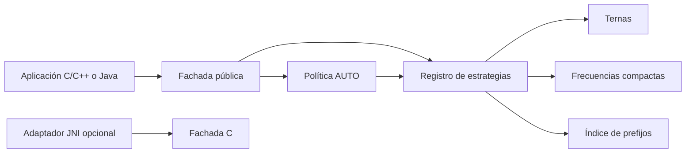
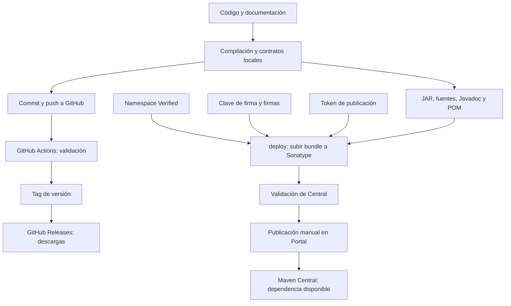

# TSPR3: proyecto, validación y despliegue

Autor: Juan Pablo Muñoz Leiva (`theforgotten-dev`).
Fecha de estado: 14 de octubre de 2026, America/Santiago.
Versión distribuida: 0.1.0. Licencia: [Apache-2.0](../LICENSE).

## 1. Objetivo y alcance

TSPR3 es una biblioteca experimental de ordenamiento de enteros de 32 bits.
La propuesta organiza datos en ternas, aprovecha sus propiedades locales y
reagrupa valores repetidos conservando sus multiplicidades. Se ofrece en dos
familias de integración: C/C++ y Java, con un puente JNI opcional hacia C.

La entrada se conserva. El ordenamiento devuelve todos los valores; la salida
compacta devuelve pares `(valor, cantidad)`. La implementación actual no ordena
estructuras genéricas ni elimina registros por compartir una clave. Esa extensión
deberá conservar la identidad y el contenido de cada registro.

El código radix histórico se mantiene en `experiments/legacy` para reproducibilidad;
no forma parte de las estrategias de la biblioteca publicada. Los resultados
experimentales dependen de la distribución y no prueban superioridad general.

## 2. Variantes del algoritmo y selección

| Estrategia | Procedimiento | Aplicación |
|---|---|---|
| A: ternas | Ordena bloques de hasta tres valores y los fusiona aprovechando extremos. | Salida ordenada completa. |
| B: frecuencias | Compacta ternas en pares de valor y cantidad; combina cantidades iguales al fusionar. | Ordenamiento y salida compacta. |
| C: índice binario | Indexa bloques compactos por prefijos; resuelve bloques que cruzan límites. | Alternativa experimental explícita. |
| AUTO | Examina una muestra y elige una estrategia. | Política independiente de los motores. |

En C, AUTO usa indicadores de repeticiones, separación de rangos, prefijos y
amplitudes logarítmicas. La transformación de perfil es:

```text
L(x) = signo(x - μ) * log2(1 + abs(x - μ) / s), con s >= 1
z_i = (x_i - c_i) / d_i
t_predicho_j = (n / 1.000.000) * exp(w_j0 + sum(w_ji * z_i))
```

Los pesos se ajustan mediante regresión ridge con λ = 0,01. Se añade un margen
conservador derivado de errores de entrenamiento y se considera el presupuesto
de memoria. La predicción decide rendimiento; el resultado sigue dependiendo
del ordenamiento completo. El margen no constituye una garantía de tiempo máximo.

Java tiene su propia política de muestreo conservadora. No reutiliza los pesos
de rendimiento C, que requieren calibración específica de lenguaje y plataforma.
C no demostró ventaja suficiente frente a B en el entrenamiento documentado y
permanece disponible como elección explícita experimental.

En el recorrido histórico de dos millones se usaron 36 escenarios y cinco
semillas: 108 entradas de entrenamiento y 72 reservadas. El selector eligió la
ruta más rápida observada en 62 de las 72 entradas reservadas. Esa reserva mide
nuevas semillas de las mismas familias, no distribuciones desconocidas. Fórmulas,
resultados y límites: [RUN-2M.md](research/RUN-2M.md). Los tiempos anteriores
no deben presentarse como mediciones nuevas de cada revisión del repositorio.

## 3. Arquitectura y componentes

El diseño combina Facade, Strategy y Selection Policy:



| Directorio | Responsabilidad |
|---|---|
| `include/tspr3` | API pública C y envoltorio C++17. |
| `src/c` y `src/c/internal` | Fachada, motores, perfil y selector C. |
| `java/src/main/java/org/tspr3` | Fachada Java, contratos de estrategias y política propia. |
| `java/native` | Puente JNI opcional que llama a la API C. |
| `tests` y `java/src/test` | Verificación de contratos, casos exhaustivos y entradas aleatorias. |
| `benchmarks` y `tools/analysis` | Mediciones y análisis reproducibles. |
| `models/c` | Pesos y procedencia del entrenamiento. |
| `scripts` y `build.ps1` | Construcción, pruebas y empaquetado. |
| `config/maven` | Plantilla que referencia credenciales mediante variables de entorno. |
| `.github/workflows/ci.yml` | Validación automatizada en GitHub Actions. |

La API C distingue argumento inválido, fallo de asignación y límite de heap.
Los buffers son propiedad del llamador; entrada y salida no deben solaparse.
El límite auxiliar predeterminado es 256 MiB y no incluye los buffers del
llamador ni toda la memoria del proceso. La salida compacta admite B/C y
AUTO selecciona B. Contratos completos: [LIBRARY.md](LIBRARY.md).

## 4. Actores y responsabilidades

| Actor o servicio | Función | Resultado o límite |
|---|---|---|
| Propietario del proyecto | Define licencia, versión, claves y autorización de publicación. | Responsable de identidad y credenciales. |
| Git y repositorio GitHub | Conservan código, cambios y tags. | Código público trazable por commit. |
| GitHub Actions | Ejecuta automáticamente el workflow al recibir push o pull request. | Pruebas y logs por ejecución. |
| Runner Windows | Proporciona el sistema y herramientas donde corre el job. | Actualmente `windows-2022`. |
| MSVC y CMake | Compilan, prueban e instalan C/C++. | Biblioteca estática, headers y paquete CMake. |
| JDK y Maven | Compilan Java, ejecutan contratos y generan documentación. | JAR, fuentes y Javadoc. |
| GPG | Firma con la clave privada del propietario. | Firmas verificables mediante la clave pública. |
| Servidor de claves públicas | Permite recuperar la clave pública de firma. | No recibe la clave privada. |
| GitHub Releases | Distribuye archivos asociados a un tag. | Descarga directa de paquetes. |
| Sonatype Central Portal | Verifica namespace, autentica publicadores y valida deployments. | Gestiona el envío y la publicación Maven. |
| Maven Central | Distribuye artefactos publicados mediante sus coordenadas. | Resolución como dependencia desde proyectos consumidores. |

Un namespace Verified acredita permiso sobre las coordenadas; no significa
que el artefacto esté publicado. Un job correcto acredita sus comprobaciones;
no significa que haya desplegado en Central. Un Release permite descargar
archivos; no los registra automáticamente como dependencias Maven.

## 5. Etapas del despliegue



### Etapa 1: construcción local

Requisitos actuales: Windows, PowerShell, MSVC con herramientas C/C++ y CMake.
Java se compila para Java 8; las herramientas Maven usan un JDK 17 o posterior.
La CI usa Temurin 21. Maven 3.9.16 se descarga en `.tools` y se verifica mediante
SHA-512; las dependencias de la construcción quedan en un caché local del proyecto.

```powershell
.\build.ps1 -Task c
.\build.ps1 -Task java -Native
.\build.ps1 -Task maven
```

Los paquetes C/C++ y Java se generan localmente. El comando Maven ordinario
ejecuta `verify`: compila, prueba y empaqueta, sin subir ni firmar.

### Etapa 2: código fuente en GitHub

Repositorio público: [theforgotten-dev/tspr3](https://github.com/theforgotten-dev/tspr3).
La rama de desarrollo publicada es `main`. El tag `v0.1.0` apunta al commit
`e609ad774ae3ff26509f1702cc85131d882c12bf`. La documentación posterior puede
evolucionar en `main` sin alterar ese tag ni los paquetes ya publicados.

### Etapa 3: GitHub Actions y sus jobs

El workflow se llama **Library contracts**. Tiene un job denominado `windows`
con estos pasos secuenciales:

| Paso | Acción | Qué comprueba |
|---|---|---|
| Checkout | `actions/checkout@v4` | Obtiene el código del commit evaluado. |
| Preparar Java | `actions/setup-java@v4`, Temurin 21 | Configura JDK y variables de entorno. |
| C and C++ package contracts | `build.ps1 -Task c` | Cuatro suites CTest, ejemplos y consumidores del paquete instalado. |
| Java and JNI contracts | `build.ps1 -Task java -Native` | Java puro, consumidor externo y puente nativo con comprobación JNI. |
| Maven sources and Javadoc | `build.ps1 -Task maven` | Contratos Java y producción de JAR, fuentes y Javadoc. |

Workflow es la definición completa; job es una unidad ejecutada en un runner;
step es un comando o acción dentro del job; run es una ejecución concreta.
Estos conceptos se describen en la [documentación de GitHub Actions](https://docs.github.com/en/actions/get-started/understand-github-actions).

El workflow actual **valida**. No contiene un paso de publicación en Sonatype
ni uno de creación automática de Releases. No usa el token de Central ni
una clave privada GPG en GitHub. Los paquetes de `v0.1.0` se construyeron
localmente y se adjuntaron al Release mediante GitHub CLI.

### Incidente: Visual Studio no encontrado

La primera ejecución solicitó el generador CMake `Visual Studio 17 2022`
en un runner `windows-latest`. Falló porque ese entorno no ofrecía una
instancia compatible con el generador solicitado. La corrección fue fijar
`runs-on: windows-2022` y ejecutar nuevamente el workflow.

| Evidencia | Resultado |
|---|---|
| [Primera ejecución 38602635257](https://github.com/theforgotten-dev/tspr3/actions/runs/38602635257) | Falló por ausencia de Visual Studio compatible. |
| [Corrección 38602765206](https://github.com/theforgotten-dev/tspr3/actions/runs/38602765206) | Todos los pasos aprobaron. |
| [Validación 38603341161](https://github.com/theforgotten-dev/tspr3/actions/runs/38603341161) | Aprobó sobre el commit del tag `v0.1.0`. |

Una ejecución fallida permanece en el historial. Para diagnosticar un fallo,
abrir **Actions → Library contracts → ejecución → windows → paso fallido**.
Comprobar el commit y el runner evita confundir errores antiguos con la versión
actual. Una repetición de la ejecución antigua utiliza su definición antigua;
el resultado relevante es el del commit que contiene la corrección.

### Etapa 4: GitHub Releases

Release público: [TSPR3 v0.1.0](https://github.com/theforgotten-dev/tspr3/releases/tag/v0.1.0).

| Archivo adjunto | Contenido |
|---|---|
| `tspr3-windows-x64-0.1.0.zip` | C/C++: headers, biblioteca estática MSVC, paquete CMake y ejemplos. |
| `tspr3-java-0.1.0.jar` | Biblioteca Java compatible con Java 8. |
| `tspr3-java-0.1.0-sources.jar` | Código fuente Java. |
| `tspr3-java-0.1.0-javadoc.jar` | Documentación de API Java. |
| `tspr3-java-windows-x64-0.1.0.zip` | JARs, licencia y puente JNI opcional Windows x64. |
| `SHA256SUMS.txt` | Hashes para verificar los archivos adjuntos. |

Los binarios nativos publicados son Windows x64; no se ha validado una
distribución Linux/macOS. El JAR puro no requiere la DLL; el consumidor
solo configura la biblioteca nativa si decide utilizar JNI.

### Etapa 5: identidad en Sonatype Central

Coordenadas previstas: `io.github.theforgotten-dev:tspr3:0.1.0`.
El propietario confirmó el namespace como **Verified** el 14 de octubre de 2026.
La confirmación procede del propietario; no se inspeccionó su sesión privada
del Portal. La propiedad correspondiente del POM refleja esa confirmación.

Ruta de consulta: usuario/correo en la esquina superior derecha de
[central.sonatype.com](https://central.sonatype.com) → **View Namespaces**.
Si falta un namespace, se agrega mediante **Add Namespace**. La verificación
es independiente de la validación de los paquetes. Véase
[Registro de namespace](https://central.sonatype.org/register/namespace/).

### Etapa 6: firma y autenticación

El propietario crea una clave GPG protegida y publica su parte pública.
El token del Portal aporta username y password de publicación; no equivale
a la contraseña de GitHub. La plantilla `config/maven/settings.example.xml`
usa `CENTRAL_TOKEN_USERNAME` y `CENTRAL_TOKEN_PASSWORD` del entorno.
La contraseña GPG se puede proporcionar mediante `MAVEN_GPG_PASSPHRASE`.

Las claves privadas y tokens se administran fuera del repositorio. La guía
[MAVEN-SETUP.md](MAVEN-SETUP.md) contiene los comandos y la entrada oculta
de secretos. La existencia de GPG por sí sola no implica que exista una clave.

### Etapa 7: subir, validar y publicar en Central

El perfil `central-release` comprueba licencia, URL y namespace; ejecuta las
pruebas; genera los artefactos; firma mediante `maven-gpg-plugin`; y usa
`central-publishing-maven-plugin` 0.11.1 al ejecutar `deploy`.

Su configuración contiene `autoPublish=false`: después de subir, el propietario
revisa el deployment y solicita su publicación en el Portal cuando sea válido.
El plugin genera los checksums del bundle. Los requisitos de fuentes, Javadoc,
POM y firmas se preparan mediante los otros plugins del proyecto. Véase
[Publicación con Maven](https://central.sonatype.org/publish/publish-portal-maven/).

Antes del envío se puede comprobar la metadata sin publicar:

```powershell
.\scripts\build-maven.ps1 -Goals @('-Pcentral-release', 'validate')
```

Esta comprobación aprobó después de definir Apache-2.0 y registrar el namespace
confirmado. No comprueba que el token autentique ni que una firma sea válida;
eso requiere las etapas posteriores.

### Etapa 8: uso como dependencia y nuevas versiones

Solo después de confirmar la publicación y su disponibilidad en Central,
un consumidor podrá resolver desde allí:

```xml
<dependency>
  <groupId>io.github.theforgotten-dev</groupId>
  <artifactId>tspr3</artifactId>
  <version>0.1.0</version>
</dependency>
```

Mientras esa publicación esté pendiente, se usa el JAR descargado de Releases
o una instalación Maven local. Maven Central no publica el paquete C/C++ actual;
este se distribuye desde GitHub Releases. Conan y vcpkg son posibles etapas
posteriores, todavía no implementadas.

Para una nueva versión: actualizar versión y documentación; ejecutar contratos;
confirmar CI del commit; preparar tag y paquetes; firmar y subir al Portal;
verificar publicación y resolución desde un consumidor externo. Mantener trazables
el commit y los hashes de cada distribución.

## 6. Estado actual y próximos pasos

| Entregable | Estado al 14 de octubre de 2026 |
|---|---|
| C/C++, Java y JNI | Implementados y probados. |
| Arquitectura Facade/Strategy/Policy | Aplicada en C y Java. |
| Código público y licencia | Publicados en GitHub bajo Apache-2.0. |
| CI del commit de v0.1.0 | Aprobada para C/C++, Java/JNI y Maven. |
| Release y archivos descargables | Publicados; seis adjuntos, incluidos checksums. |
| Namespace Sonatype | Verified según confirmación del propietario. |
| Validación local de metadata de publicación | Aprobada. |
| Clave pública GPG | Publicada en keyserver.ubuntu.com y descargada para comprobar su huella. |
| Firmas del JAR, fuentes, Javadoc y POM | Verificadas localmente: cuatro firmas válidas. |
| Token de publicación | Creación confirmada por el propietario; no se registra su contenido. |
| Bundle de Central | Generado localmente y revisado; coincide con los artefactos firmados. |
| Deployment en el Portal | Estado remoto todavía no inspeccionado. |
| Publicación en Maven Central | No confirmada: la consulta del POM público devolvió HTTP 404. |
| Registros genéricos, Conan/vcpkg y Linux/macOS | Etapas futuras. |

Se resolvió un fallo de `keyboxd` del GPG incluido en Git preparando un almacén
exclusivo para TSPR3. La clave se generó posteriormente y su parte pública se
publicó. La contraseña y el token se introducen localmente con entrada oculta
mediante `scripts/publish-central.ps1`; no se incluyen en los paquetes.

La revisión del bundle no encontró imágenes, scripts de PowerShell, claves
privadas ni credenciales. Incluye JAR, fuentes, Javadoc y POM con firmas y
checksums. El nombre de autoría es público y la clave GPG pública identifica
al firmante. La revisión no constituye una garantía absoluta de ausencia de errores.

Las evidencias locales incluyen cuatro suites CTest, 90.399 entradas del núcleo,
23.352 entradas Java y pruebas adicionales Java/JNI con tres entradas de dos
millones. Detalles y reproducción: [VALIDATION.md](VALIDATION.md).

El siguiente recorrido operativo es comprobar el deployment en Sonatype,
resolver cualquier error de validación, publicar y comprobar la resolución
desde un proyecto independiente. Un HTTP 404 en el repositorio público no
determina por sí solo si existe un deployment pendiente dentro del Portal.
